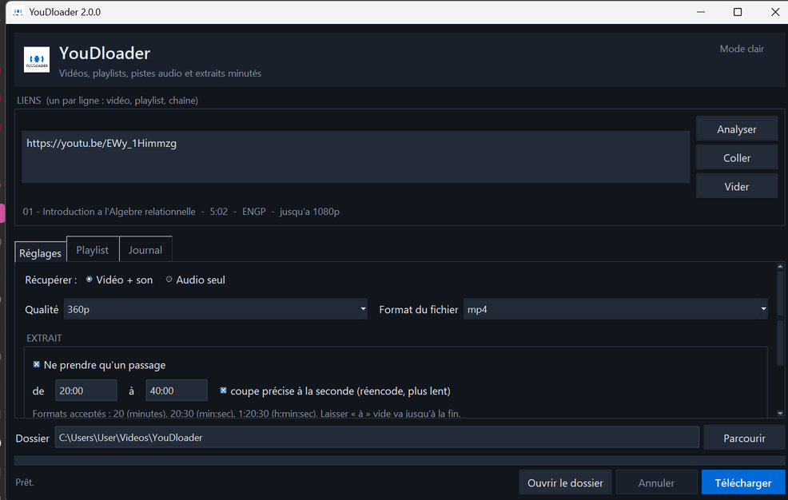
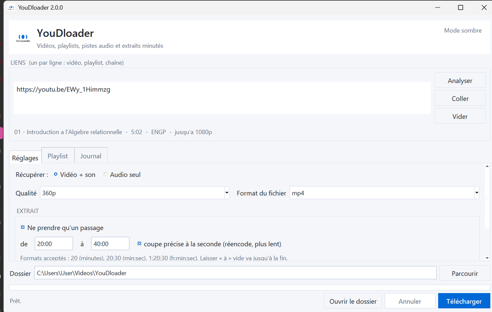

# YouDloader

Télécharger une vidéo, une playlist entière, une piste audio, ou **seulement le passage
qui t'intéresse** : de la 20e à la 40e minute, par exemple.

Interface de bureau pour Windows, ligne de commande, et version web dans Docker. Le même
moteur derrière les trois.

| Thème sombre                                          | Thème clair                                           |
| ----------------------------------------------------- | ----------------------------------------------------- |
|  |   |

> Reprise du YouDloader de 2024. Le logo et l'identité sont conservés ; le moteur, lui,
> a été entièrement refait : `pytube`, sur lequel reposait la première version, n'est plus
> maintenu et ne fonctionne plus avec YouTube. C'est `yt-dlp` qui prend le relais.

## Ce que ça fait

- Une vidéo, une playlist complète, ou une liste de liens collés d'un coup.
- Vidéo + son, ou audio seul en m4a, mp3, opus ou wav.
- Qualité au choix, 360p par défaut, jusqu'à la meilleure disponible.
- **Extrait minuté** : `de 20:00 à 40:00`, avec coupe précise à la seconde.
- Sous-titres, y compris ceux générés automatiquement, convertis en `.srt`.
- Numérotation des fichiers dans l'ordre des liens, pour garder l'ordre d'un cours.
- Reprise après coupure : relancer la même commande ne retélécharge pas l'existant.
- Choix des vidéos d'une playlist, une par une.
- Cookies du navigateur, pour les vidéos réservées aux comptes connectés.
- Thème sombre ou clair, réglages mémorisés d'une fois sur l'autre.

## Installer

Le détail, les avertissements de Windows et les pannes courantes sont dans
**[INSTALL.md](INSTALL.md)**. En résumé :

**Windows, sans rien installer.** Prendre `YouDloader.exe` dans les
[Releases](https://github.com/Patrickleondev/YouDloader/releases) et le lancer.
Windows affiche un avertissement SmartScreen parce que l'exe n'est pas signé :
*Informations complémentaires*, puis *Exécuter quand même*.

**Android.** Prendre l'APK dans les Releases : `arm64-v8a` pour presque tous les
téléphones depuis 2017, `armeabi-v7a` pour les plus anciens. Autoriser l'installation
depuis le navigateur ou l'appli Fichiers quand Android le demande. Depuis YouTube,
**Partager > YouDloader** remplit le lien tout seul.

**Dans le navigateur, via Docker.**

```bash
docker compose up -d        # puis http://127.0.0.1:8080
```

**Depuis les sources**, pour modifier le code ou utiliser la ligne de commande.

```powershell
python -m venv venv
venv\Scripts\python -m pip install -r requirements.txt
venv\Scripts\python bureau.py
```

## Ligne de commande

```powershell
venv\Scripts\python -m youdloader.cli URL
venv\Scripts\python -m youdloader.cli URL_PLAYLIST -q 480 -n -s
venv\Scripts\python -m youdloader.cli URL --audio --format mp3
venv\Scripts\python -m youdloader.cli URL --de 20 --a 40        # 20e à 40e minute
venv\Scripts\python -m youdloader.cli -f liens.txt -o "D:\Cours"
venv\Scripts\python -m youdloader.cli --installer-prerequis   # ffmpeg et Node
```

Les durées s'écrivent `20` (minutes), `20:30` (min:sec) ou `1:20:30` (h:min:sec).

## Comment c'est organisé

```text
youdloader/
  core.py         moteur : réglages -> options yt-dlp, analyse, téléchargement
  gui.py          interface Tkinter
  theme.py        palettes sombre et claire
  ffmpeg_auto.py  détection et installation automatique de ffmpeg
  node_auto.py    détection et installation automatique de Node
  cli.py          ligne de commande
web/              serveur FastAPI, page unique, image Docker
android/          application Android (Java), mêmes réglages que core.py
scripts/          publication des versions
bureau.py         point d'entrée de l'application de bureau
build_exe.py      fabrication de l'exécutable
```

Tout ce qui touche au téléchargement vit dans `core.py`. L'interface, la ligne de
commande et le serveur web ne font que remplir un objet `Reglages` et le lui passer :
une correction dans le moteur profite aux trois d'un coup.

## Quelques décisions, et pourquoi

**`format_sort: res:360` plutôt qu'un filtre `height<=360`.** Le filtre ne renvoie rien
si la vidéo n'a aucun flux inférieur ou égal à 360p, et le téléchargement échoue. Le tri
prend la résolution la plus proche par en dessous, et à défaut la plus basse au-dessus.

**Pas d'archive de reprise quand on prend un extrait.** `archive.txt` note les vidéos
terminées pour ne pas les refaire. Un extrait y inscrirait la vidéo comme faite, et la
version complète serait ignorée ensuite.

**Réencodage par défaut à la découpe.** Sans lui, la coupe tombe sur l'image clé
précédente, jusqu'à une dizaine de secondes avant la borne demandée. L'option de coupe
rapide reste là quand la précision n'importe pas.

**ffmpeg et Node téléchargés à la demande plutôt qu'embarqués.** L'exe reste à 26 Mo
au lieu de 250. Au premier lancement, s'il en manque un, l'application propose de
l'installer tout de suite : sa propre copie dans `%LOCALAPPDATA%\YouDloader\bin`, depuis
les sites officiels, sans droits administrateur et sans toucher au reste du système.

**Node est nécessaire.** YouTube exige d'exécuter du JavaScript pour livrer ses flux ;
yt-dlp délègue à un moteur externe. Sans lui, il ne reste qu'une partie des formats,
souvent aucun qui contienne le son. L'image Docker l'embarque.

**Sans ffmpeg, jamais de vidéo muette.** Le format `bv*+ba` prend la meilleure image et
le meilleur son, puis demande à ffmpeg de les coller. Sans ffmpeg, yt-dlp laissait les
deux fichiers séparés : une vidéo muette et un `.m4a`. Le moteur demande alors un format
qui contient déjà les deux (`b`), quitte à baisser la qualité.

**Le port du serveur web est lié à `127.0.0.1`.** Ce service n'a ni comptes ni quotas :
exposé sur Internet, il deviendrait un relais de téléchargement ouvert à tous.

## L'application Android

Android n'a ni Python, ni Node, ni ffmpeg, et depuis Android 10 une appli ne peut plus
exécuter un programme qu'elle a téléchargé. L'APK s'appuie donc sur
[youtubedl-android](https://github.com/yausername/youtubedl-android) 0.18.1, qui embarque
Python, yt-dlp, ffmpeg et QuickJS sous forme de bibliothèques natives, extraites à
l'installation (`extractNativeLibs`). QuickJS joue le rôle de Node pour le JavaScript
de YouTube.

- `Reglages.java` traduit les choix en options yt-dlp, comme `construire()` dans
  `core.py`. Seule différence : à résolution égale, H.264 passe avant AV1, que beaucoup
  de téléphones d'avant 2022 ne décodent pas.
- `TelechargementService.java` lance yt-dlp dans un service au premier plan (type
  `dataSync`) : le téléchargement continue écran éteint, avec une notification et un
  bouton Annuler.
- yt-dlp travaille dans le dossier privé de l'appli, puis `Publication.java` copie chaque
  fichier fini dans `Téléchargements/YouDloader` (MediaStore, sans permission depuis
  Android 10).
- yt-dlp se met à jour tout seul une fois par jour depuis ses releases GitHub, et à la
  demande par le menu.
- Un APK par architecture : Python et ffmpeg pèsent environ 51 Mo chacune, un APK
  universel dépasserait 200 Mo.

Construire : ouvrir `android/` dans Android Studio, ou
`android\gradlew -p android assembleRelease`. Les APK sortent dans
`android/app/build/outputs/apk/release/`.

Testé sur l'émulateur (Android 17) : partage d'un lien depuis une autre appli,
vidéo 360p (H.264 et AAC, image et son vérifiés avec ffprobe), extrait de 9 s en m4a et
en mp3, service au premier plan pendant que l'appli est en arrière-plan.

## Publier une version

Voir **[DEPLOIEMENT.md](DEPLOIEMENT.md)**. En résumé : `scripts/publier.py` vérifie que
l'arbre git est propre, construit l'exe, calcule son empreinte SHA-256, pose l'étiquette
et crée la release GitHub avec l'exe en pièce jointe.

Le workflow GitHub Actions est écrit et prêt, mais il ne démarre pas tant que la
facturation du compte est bloquée. La publication se fait donc depuis la machine.

## Ce qui reste à faire

- File d'attente et reprise sélective dans l'interface de bureau.
- Conversion du son en mp3 sans passer par un réencodage quand la source le permet.

## Limites connues

- Le mode extrait n'affiche pas de pourcentage : la découpe passe par ffmpeg, qui ne
  communique pas de taille totale. La barre devient une animation d'attente.
- `--format m4a` sur une source Opus réencode, donc perd un peu de qualité.
- Les sous-titres automatiques de YouTube se trompent sur les termes techniques.

## Légal

Cet outil est fait pour les cours, les conférences et les contenus libres. Télécharger
un contenu protégé sans autorisation reste contraire aux conditions d'utilisation de
YouTube et, selon les cas, au droit d'auteur.
